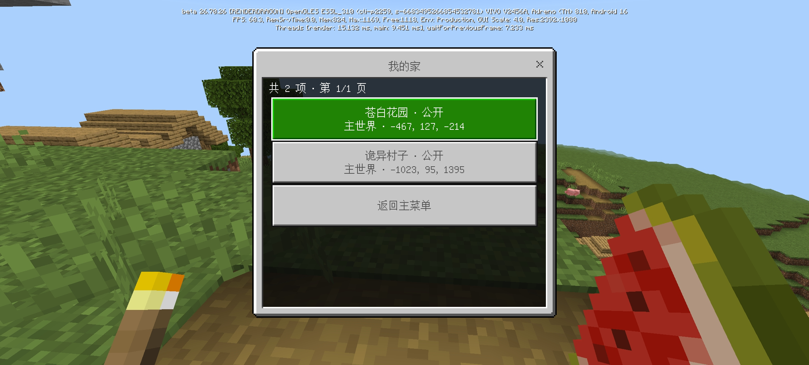

# HuskHomes Bedrock · 家与传送

[下载最新版](https://github.com/leemwood/huskhomes-bedrock/releases/latest) · [报告问题](https://github.com/leemwood/huskhomes-bedrock/issues) · [MIT 许可证](LICENSE)



截图由项目使用者提供，展示 Preview 26.70.26 Android 客户端中的实际画面。


面向 **Minecraft Bedrock Preview 26.70.26 / BDS 1.26.70.26** 的独立行为包，使用 `@minecraft/server` 2.11.0 和 `@minecraft/server-ui` 2.3.0。提供 HuskHomes 常用的家与传送功能及中文原生表单；没有复制上游插件代码，也不是官方 HuskHomes 项目。

## 使用

输入 **`/hh:menu`** 打开菜单。也监听潜行使用普通指南针的事件作为快捷入口；不同客户端的指南针交互行为可能不同，命令入口始终可用。所有普通玩家命令均不要求开启作弊。推荐使用带 `hh:` 命名空间的命令，避免和其他行为包提供的 `/home` 等简写产生冲突。

- 我的家：创建、命名、描述、改名、更新位置、删除、公开或设为私有。普通玩家上限 5 个，管理员上限 50 个，另受单条存储容量限制。
- 公开家：其他玩家可以到访；主人离线后仍可访问。到达前再次检查是否仍然公开。
- 公共传送点和主城：管理员在表单中管理，全体玩家使用。插件主城不改变原版床、重生锚或死亡重生机制。
- TPA / TPAHere：请求到别人身边，或邀请别人到自己这里。必须由收件人明确接受，60 秒过期，可拒绝、撤回或关闭接收；同一人发送间隔 5 秒。
- 返回上个地点、返回死亡地点、最近 10 次传送的出发地点、主世界随机传送。

默认传送等待 3 秒，移动超过 0.5 格、切换维度、受伤、死亡或离线会取消。成功传送后冷却 10 秒；受伤或参与战斗后 10 秒内不能发起传送。管理员遵守相同传送等待和安全检查。

死亡和重生会清除本插件的受伤／战斗标记、传送冷却、请求发送冷却、双方相关的待处理请求、读条及旧表单会话；家、公开设置和死亡地点保留。死亡前排队的延迟命令不会在重生后执行。这里清理的是插件状态，不修改原版药水、燃烧等生存机制。

## 命令

名称参数可省略时会打开相应表单。有空格的名称使用双引号，例如 `/hh:sethome "山顶 小屋"`。

| 命令 | 用途 |
| --- | --- |
| `/hh:menu` | 主菜单 |
| `/hh:homes`、`/hh:home [名称]` | 家列表、前往家 |
| `/hh:sethome [名称]` | 创建家，省略名称打开创建表单 |
| `/hh:edithome [名称]` | 编辑家，更新坐标在家详情页操作 |
| `/hh:delhome <名称>` | 删除家，需要表单确认 |
| `/hh:publichomes` | 公开家列表 |
| `/hh:warps`、`/hh:warp [名称]` | 公共传送点列表、前往传送点 |
| `/hh:spawn` | 前往插件主城；未设置时尝试世界默认出生点表面 |
| `/hh:back`、`/hh:death` | 返回上个地点、死亡地点 |
| `/hh:history` | 最近出发地点列表 |
| `/hh:rtp` | 主世界随机传送 |
| `/hh:tpa [完整玩家名]` | 请求到别人身边 |
| `/hh:tpahere [完整玩家名]` | 邀请别人到自己这里 |
| `/hh:requests` | 逐条查看请求，明确选择接受或拒绝 |
| `/hh:tpaccept`、`/hh:tpdeny` | 接受或拒绝最新收到的请求 |
| `/hh:tpcancel` | 取消当前读条、加载中的传送，撤回发出的请求 |
| `/hh:tptoggle` | 开关接收请求 |
| `/hh:setwarp [名称]` | 管理员：创建公共传送点 |
| `/hh:delwarp [名称]` | 管理员：删除公共传送点，需确认 |
| `/hh:setspawn` | 管理员：设置插件主城，需确认 |

名称支持汉字、字母、数字、空格、下划线、短横线，最多 24 个 UTF-16 字符，大小写和全角半角规范化后不能重名；描述最多 100 个 UTF-16 字符。管理员以原版操作员或命令管理员权限判断，不使用可自行伪造的玩家标签。命令需要由游戏内玩家执行，服务器控制台可以通过 `help hh:menu` 查询命令。

## 落点安全与性能

检查脚部、头部空间和脚下碰撞表面，排除岩浆、火、仙人掌、岩浆块等危险方块，以及邻近八个方向的火和岩浆。使用脚底中心与四角的射线测量实际表面高度，支持上下半砖、台阶、地毯、雪层、耕地和土径；无碰撞的常见草丛和花不会阻止传送。兼容当前预览版完整方块顶面高度返回 0 的行为。

保存位置被堵住时，在水平半径 2 格、上下 4 格内按距离优先寻找落脚点；找不到就取消。不会清除方块或生成平台。水中、含水的光源方块、头部空间不足和无法可靠识别的特殊结构仍会拒绝传送。

随机传送以世界默认出生点为中心，在主世界水平距离 256–2000 格内最多尝试 4 个区域，只接受安全地表。每个区域优先复用最多 9 个附近地表采样列，避免一列不安全就生成另一片远方地形。全服同时仅准备一个 RTP；每次区域尝试之间至少间隔 10 tick，总准备时限 20 秒。RTP 单人冷却 60 秒、全服启动间隔 15 秒，取消或失败也计入，防止反复生成新区块。取消时会停止后续尝试，已经进入原生引擎的区块加载需要等待其完成。

远处落点预加载以目标区块为中心的 **3×3 个区块**，区块就绪后等待 2 tick，再检查并传送；临时区块在找到落点后继续保留 100 tick，给玩家的正常加载范围留出交接时间。并发原生区块加载上限为 1，最多保留 2 个临时区域，加载之间至少间隔 10 tick，单次原生加载等待上限 200 tick。原生加载超时后仍占用并发名额直到调用结束，避免重复请求堆积。加载失败或无安全落点时正常提示取消。所有坐标都由服务器读取，不信任客户端提交的落点。

新区块首次生成、照明和网络发送仍需要时间；插件超时只能终止后续尝试，不能抢占正在运行的引擎任务。BDS 最大视距过大时，传送后会触发更大范围的地形生成和网络发送；可根据硬件和玩家量使用 `view-distance=12`、`tick-distance=4` 作为起点；行为包本身不会修改服务器视距。控制台会记录 `[HuskHomes:RTP]` 的准备耗时，便于排查地形或客户端加载问题。

每 2 tick 仅检查进行中的传送、请求和短期冷却，不扫描实体或遍历世界方块。表单列表分页，每页 12 项。只有编辑设置、成功传送、死亡及首次建档等事件会写存档。首次加载会读取所有本包玩家记录，以支持离线公开家；大型服务器需要根据玩家量评估内存。

安全检测与传送之间世界仍可能被其他玩家、流体或其他插件改变；实际传送启用引擎碰撞检查，失败会取消并恢复返回点和冷却记录。死亡地点位于虚空、岩浆或危险区域时可能无法返回。

## 存档、安装和配置

家、公开状态、公共点、主城、返回点、死亡地点、历史记录和请求开关都保存在世界动态属性中。玩家使用持久标识关联数据，更改昵称不会丢家；请求和正在进行的传送在重启后清空。损坏的数据保留原值并报错，不会用空记录覆盖。单条玩家／公共数据序列化上限 10000 字符，容量满时拒绝新增或变更并提示。完整世界备份包含传送数据；更改本包 header UUID 会使原存档数据不可见。

客户端：导入 `dist/HuskHomes-Bedrock-1.0.2.mcaddon` 或 `.mcpack`，在世界的行为包列表中启用本包即可，无需资源包。本包本身使用稳定 API，不要求开启 Beta API 实验。1.0.2 保持原 UUID，可以保留数据直接更新。

BDS：正常停服并备份世界，将 `packs/HuskHomes_BP` 复制到 `behavior_packs/HuskHomes_BP`，然后在目标世界的 `world_behavior_packs.json` 数组中追加以下项目，保留其他项目：

```json
{"pack_id":"7e7bb539-c59d-4c64-a07f-4f5cb6fad61c","version":[1,0,2]}
```

重启并确认日志出现 `[HuskHomes] 1.0.2 已加载`。修改 `packs/HuskHomes_BP/scripts/config.js` 中的数量、等待、冷却、随机范围等参数后，重新打包或复制到服务器并重启。服务器维护重启前应先广播通知玩家并倒计时，再正常停服保存和备份。

这是单世界存档的基岩脚本实现，不提供 Java JAR 执行、HuskHomes SQL 数据库兼容、Java 版原始数据自动导入、跨服务器传送、经济收费或 LuckPerms 集成。备份服务器已有世界即可备份本包数据。

## 开发验证

```powershell
npm ci
npm run check
npm test
npm run build
```

需要 Node.js 22.15+（推荐 24）、npm 和 Python 3.10+。Windows PowerShell 如限制 npm.ps1，可使用 npm.cmd。

独立测试共 **49 项**，使用原生 API 的替身覆盖存档、权限、TPA、读条取消、加载超时、落点检查、表单和入口注册。已在同版本 BDS 独立测试世界验证碰撞表面、新地形生成、tick 心跳及原生实体传送，并收到 Android Preview 客户端的家列表和传送截图；这不等于所有设备和地形均已测试。新区块生成仍可能带来短暂卡顿。构建仅使用 Python 标准库，生成可重复的压缩包与 SHA-256 校验文件。

## 可选的 Windows BDS 维护工具

`tools/restart_bds.py` 是独立的服务器运维工具，不是行为包运行依赖。仅适用于由现有可见 `cmd.exe` → Python 控制台包装器 → BDS 启动、并生成 `server-console-process.json` 与 `server-console.log` 的环境；普通 BDS 安装请通过自己的控制台手动广播和正常停服。

```powershell
python tools/restart_bds.py --server "C:/path/to/bds"
```

工具先用 tellraw 广播 60 秒倒计时，确认命令处理后正常停服，并在原来的可见终端中启动 `start-server.cmd`。`--update-pack dist/HuskHomes-Bedrock-1.0.2.mcpack` 可在停服后备份完整世界及行为包、更新本包和世界行为包列表；只有显式传入 `--view-distance 12` 才会修改服务端视距。不要公开世界、日志、玩家权限列表或服务器凭据。
